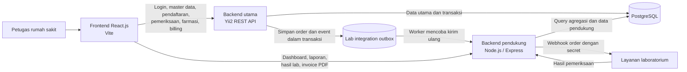

# Arsitektur dan Alur Komunikasi

## Diagram

PostgreSQL adalah penyimpanan bersama. Yii menjadi pemilik aturan transaksi SIMRS. Node.js membaca data yang dibutuhkan untuk dashboard, menghasilkan invoice PDF, dan menjadi lapisan integrasi pemeriksaan penunjang. Node tidak menggantikan validasi transaksi inti Yii.

## Contoh alur rawat jalan

1. Petugas mencari pasien yang aktif atau mendaftarkan pasien baru melalui React. Permintaan data pasien dan pendaftaran dikirim ke API Yii.
2. Yii memeriksa jadwal dan kuota, mengunci data yang perlu dijaga dari permintaan bersamaan, lalu menyimpan kunjungan beserta nomor antrean ke PostgreSQL.
3. Dokter membuka antrean dan menyimpan anamnesis, tanda vital, diagnosis, tindakan, permintaan laboratorium, serta resep melalui Yii.
4. Jika ada order laboratorium, Yii menyimpan order dan event outbox dalam transaksi yang sama. Proses dispatcher mengirim event ke Node. Jika Node tidak tersedia, event tetap tersimpan dan bisa dicoba kembali.
5. Petugas laboratorium mengisi hasil melalui layanan Node; hasil tersimpan di PostgreSQL dan dapat dibaca kembali dari halaman pelayanan.
6. Yii menyusun rincian billing. Kasir melakukan pembayaran melalui Yii dengan idempotency key agar request ulang tidak membuat transaksi baru.
7. Sesudah tagihan lunas, farmasi dapat menyerahkan obat. Yii mengurangi stok dalam transaksi yang mengunci baris obat.
8. React meminta invoice PDF ke Node, yang membaca ringkasan billing dan informasi kunjungan dari PostgreSQL.

## Pembagian tanggung jawab

| Bagian | Tanggung jawab
| React | Tampilan tiap role, formulir, navigasi, pemanggilan REST API, dan menampilkan status atau pesan hasil. |
| Yii2 | Autentikasi dan izin di layanan utama, master data, pendaftaran, antrean, rekam medis, tindakan, resep, billing, pembayaran, transaksi, dan audit. |
| Node.js | API pendukung dashboard/laporan, layanan integrasi lab, pembuatan PDF invoice, validasi request, serta format error API yang konsisten. |
| PostgreSQL | Menyimpan data bersama; menjaga relasi, transaksi, keunikan, dan batasan stok. |

Komunikasi React ke Yii dan Node memakai HTTP JSON. Token akses dikirim sebagai `Authorization: Bearer <token>` untuk endpoint yang memerlukannya. Komunikasi antarservice untuk order lab memakai webhook internal yang dilindungi secret dari konfigurasi environment.
